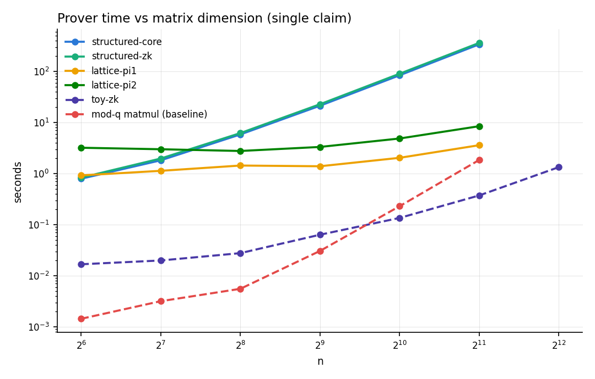
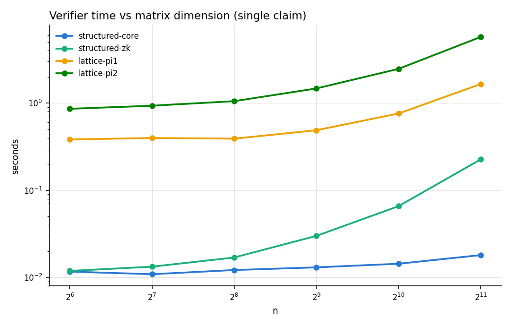
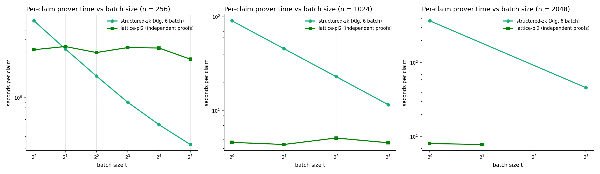
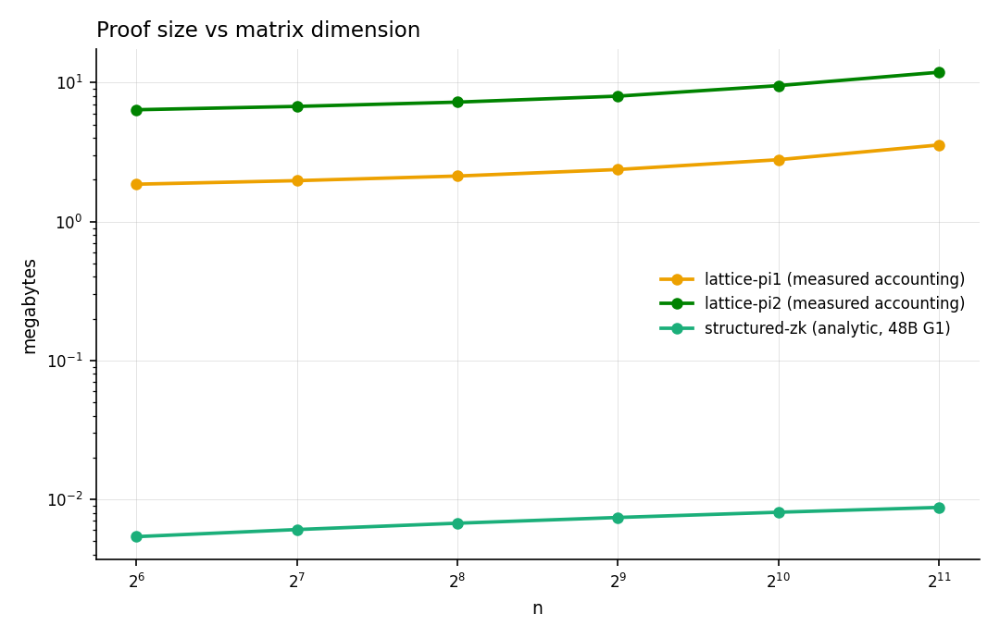

# Pairing vs Lattice: Same-Machine Runtime Comparison

Head-to-head runtime measurements of the two proof tracks, run sequentially
on one machine so the numbers are directly comparable.

- **Pairing track**: `structured_matrix` (Rust, BLS12-381 via blstrs/blst,
  KZG fast verifier, Algorithm-6 batching), plus the `zkmatrix-rs` toy
  backend (u64 mock group) as a protocol-algebra scaling reference.
- **Lattice track**: `lattice_matmul` (Rust, Route Z, `q = 2^61 - 1`,
  parameters derived from the report's constraint system at a 128-bit
  target: Pi1 `b=8, r=37`, Pi2 `b=6, r=64`, `k` from C3, `N` from C4).

Environment: Intel Core Ultra 9 185H, 22 threads, WSL2, Rust 1.96,
sequential execution (one benchmark process at a time, shared rayon
defaults). Raw CSVs, metadata, and plots: `results/track_comparison/`.
Reproduce with:

```bash
python3 scripts/benchmark_track_comparison.py run   # streams results live
python3 scripts/benchmark_track_comparison.py plot
```

Caveats before reading any number:

- The lattice backend's Gaussian sampler and rejection decision use f64
  (production needs fixed point) and a seeded PRNG; costs are
  representative, transcripts are real, but it is a benchmark build.
- The structured backend's `tau` is generated locally (benchmark setup,
  not a ceremony). The toy backend is not cryptographically binding at
  all — it is included only to show protocol-algebra scaling.
- Lattice C3/C4 sizing is the report's design model; a deployment would
  re-validate `k`, `N` with the lattice estimator.

## 1. Dimension scaling (single claim, n x n matrices)





### Lattice track (measured)

| protocol | n | k | N | CRS s | matmul s | commit s | prove s | verify s | proof MB |
|---|---|---|---|---|---|---|---|---|---|
| Pi1 | 64 | 1247 | 5376 | 0.02 | 0.001 | 0.13 | 0.92 | 0.38 | 1.9 |
| Pi1 | 256 | 1380 | 5696 | 0.02 | 0.006 | 0.50 | 1.44 | 0.39 | 2.1 |
| Pi1 | 1024 | 1528 | 6592 | 0.03 | 0.23 | 3.31 | 2.03 | 0.76 | 2.8 |
| Pi1 | 2048 | 1612 | 7680 | 0.04 | 1.84 | 12.00 | 3.59 | 1.66 | 3.6 |
| Pi2 | 64 | 1832 | 5952 | 0.02 | 0.001 | 0.24 | 3.20 | 0.86 | 6.4 |
| Pi2 | 256 | 1991 | 6272 | 0.02 | 0.005 | 1.05 | 2.77 | 1.05 | 7.2 |
| Pi2 | 1024 | 2167 | 7232 | 0.03 | 0.24 | 7.11 | 4.85 | 2.48 | 9.5 |
| Pi2 | 2048 | 2266 | 8320 | 0.05 | 1.85 | 22.23 | 8.45 | 5.76 | 11.9 |

(Full precision in `results/track_comparison/lattice_scaling.csv`.)

The signature property is how *flat* these curves are: from n = 64 to
n = 2048 (a 1024x growth in matrix entries), Pi1 proving grows only
3.9x and Pi2 only 2.6x. The proof cost is dominated by `r * (k+n) * N`
commitments to masks, and `k`, `N` grow only logarithmically with `n`
(through the norm bound beta). The per-matrix commitment cost is the
part that scales with the matrix (`m` columns of `(k+n) x N` work), and
even it is ~12-22 s at n = 2048 — one-time per committed matrix and
amortized over every proof made against it. Setup (CRS expansion from a
seed) is milliseconds and transparent: there is no trusted ceremony and
no per-shape SRS.

### Pairing track (measured)

| mode | n | setup s | commit s | prove s | verify s |
|---|---|---|---|---|---|
| core | 64 | 0.81 | 0.007 | 0.79 | 0.012 |
| zk | 64 | 0.92 | 0.007 | 0.83 | 0.012 |
| core | 256 | 13.5 | 0.085 | 5.83 | 0.012 |
| zk | 256 | 13.6 | 0.083 | 6.19 | 0.017 |
| core | 512 | 54.1 | 0.31 | 21.2 | 0.013 |
| zk | 512 | 54.0 | 0.32 | 22.7 | 0.030 |
| core | 1024 | 214.0 | 1.20 | 83.6 | 0.014 |
| zk | 1024 | 213.7 | 1.16 | 89.8 | 0.066 |
| core | 2048 | 856.2 | 5.56 | 337.5 | 0.018 |
| zk | 2048 | 841.1 | 5.07 | 360.3 | 0.227 |

(Full precision in `results/track_comparison/structured_scaling.csv`; the
core and zk curves overlap almost exactly — the ZK masking layer costs a
few percent on top of the MSM-dominated core proof.)

The shapes are opposite to the lattice track. Structured proving grows
essentially with the witness area (`~n^2` MSM work): 0.83 s at n = 64 to
89.8 s at n = 1024, a 108x increase over a 256x area increase.
Verification is where this track shines: the KZG fast verifier is
12-66 ms at every size measured — `O(log n)` hashing plus two pairing
checks per sub-proof, nearly flat in n. Setup is the structural
liability: the per-shape SRS costs 214 s at n = 1024 (serial tau-power
generation, `O(n^2)` points, ~150 MB) and must come from a trusted
ceremony in any deployment.

### Toy backend (protocol algebra only, u64 mock group)

| n | exact matmul s | prove s | verify s | prove / matmul |
|---|---|---|---|---|
| 64 | 0.001 | 0.017 | 0.004 | 15.5 |
| 256 | 0.009 | 0.028 | 0.007 | 3.2 |
| 1024 | 0.286 | 0.135 | 0.040 | 0.47 |
| 2048 | 2.345 | 0.373 | 0.130 | 0.16 |
| 4096 | 18.973 | 1.333 | 0.403 | 0.07 |

The toy numbers bound how fast the zkMatrix protocol algebra could ever
be if group operations were one word-multiply: the crossover against
dense modular matmul happens near n = 512 on this machine. The gap
between the toy and structured rows is the price of real 381-bit curve
arithmetic.

## 2. Batch scaling (t same-shape claims)



Both systems prove `t` independent same-shape claims (`t` fresh matrix
triples, commitments per claim). The structured backend uses the paper's
Algorithm 6 batching (one set of length-`n^2` projection proofs for the
whole batch, one length-`n` product proof per claim); Route Z has no
cross-claim batching, so the lattice per-claim cost is flat by
construction.

n = 256, per-claim seconds:

| t | structured-zk prove | lattice-pi2 prove | structured-zk verify | lattice-pi2 verify |
|---|---|---|---|---|
| 1 | 6.25 | 3.14 | 0.0139 | 1.08 |
| 2 | 3.20 | 3.39 | 0.0086 | 1.08 |
| 4 | 1.68 | 2.94 | 0.0058 | 1.08 |
| 8 | 0.90 | 3.31 | 0.0049 | 1.09 |
| 16 | 0.53 | 3.27 | 0.0037 | 1.10 |
| 32 | 0.33 | 2.51 | 0.0045 | 1.09 |

n = 1024, per-claim seconds:

| t | structured-zk prove | lattice-pi2 prove | structured-zk verify | lattice-pi2 verify |
|---|---|---|---|---|
| 1 | 90.58 | 4.63 | 0.0163 | 2.68 |
| 2 | 45.81 | 4.39 | 0.0099 | 2.53 |
| 4 | 23.15 | 5.15 | 0.0070 | 2.54 |
| 8 | 11.66 | 4.58 | 0.0056 | 2.53 |

Fitted batch model (this machine): structured-zk total prove is
`6.1 s + 0.14 s * t` at n = 256 and `90.3 s + 0.39 s * t` at n = 1024 —
the same fixed-plus-tiny-marginal shape as the earlier Apple Silicon
fits, about 2.4x slower overall on this CPU. Crossovers against the flat
lattice line:

- n = 256: structured wins the per-claim prover race from `t = 2`.
- n = 1024: prove-only crossover at `t ~ 21`; counting per-claim commit
  costs too (structured 1.25 s vs lattice 7.4 s per claim), the all-in
  crossover drops to `t ~ 9`.
- Verification: batched structured verification is 4-16 ms per claim —
  200-500x faster than the lattice verifier at every batch size.

n = 2048, per-claim seconds (measured; structured series at t = 1, 8):

| t | structured-zk prove | lattice-pi2 prove | structured-zk verify | lattice-pi2 verify |
|---|---|---|---|---|
| 1 | 367.8 | 8.10 | 0.0169 | 5.56 |
| 2 | — | 7.87 | — | 7.42 |
| 8 | 46.0 | — | 0.0053 | — |

The structured batch totals at t = 1 and t = 8 are within 0.2 s of each
other (367.8 vs 368.0), i.e. the measured marginal cost per additional
claim is below run-to-run noise (< ~1 s; the model value scaled from
n = 1024 is ~0.8 s). The batch prover is purely the fixed `~n^2` cost,
divided by t. Crossovers against the flat lattice line (~8.0 s/claim):

- Prove only: `368/t < 8.0` gives `t ~ 46-50`; with the implementation's
  power-of-two batches, **t = 64** is the first batch size where the
  structured per-claim prover beats the lattice prover at n = 2048
  (projected ~6.2 s/claim vs 8.0 s).
- Including per-claim commitments (fresh matrices each claim: structured
  5.4 s vs lattice 22.6 s per claim), the all-in crossover drops to
  **t ~ 15-16**.
- Including one-time setup amortization as well (866 s per shape), the
  crossover moves back out to `t ~ 50`.
- Verification stays a structured landslide at every t (5-17 ms vs
  5.6-7.4 s per claim, ~1000x).

## 3. Proof sizes



Lattice proofs are megabytes (linear in `r * N`): 2.8 MB (Pi1) / 9.5 MB
(Pi2) at n = 1024. Structured zkMatrix proofs are kilobytes (logarithmic
in n): roughly 8 KB for a single zk proof at n = 1024 (analytic count:
three length-n^2 masked projection IPAs at 2*log2(n^2)+1 G1 points each,
one length-n product IPA, KZG witnesses, and a handful of commitments and
scalars at 48 B per compressed G1 / 32 B per scalar). This is the single
largest structural gap between the tracks, and it is exactly the gap the
report's Route R (ring) lift and LaBRADOR-style folding are designed to
close (projected 50-150 KB, then sublinear).

## 4. Reading the results

**The two tracks have opposite performance shapes, and the numbers are
now concrete enough to plan around.**

1. **Single-claim proving: lattice, decisively, and more so as n grows.**
   At n = 256 the all-hidden lattice proof (Pi2) is 2x faster than
   structured-zk (2.8 s vs 6.2 s); at n = 1024 it is 18x faster (4.9 s
   vs 89.8 s); at n = 2048 it is 43x faster (8.4 s vs 360.3 s,
   measured). The reason is structural: the
   lattice prover's per-proof work is `r * (k+n) * N` word-multiplies
   with `k, N` growing only logarithmically in n, while the pairing
   prover does `~n^2`-size MSMs over 381-bit points. If the workload is
   "prove one large matmul with low latency," the lattice track wins
   outright. (Pi1, the public-A statement, is cheaper still — 2.0 s at
   n = 1024 — but note it proves a weaker statement than structured-zk.)

2. **Verification: pairing, by two to three orders of magnitude.** The
   KZG fast verifier is 12-66 ms flat; the lattice verifier re-runs the
   `r * (k+n) * N` linear algebra and costs 0.4-5.8 s, growing with the
   same (gentle) slope as its prover. In a many-verifiers or on-chain
   setting this asymmetry dominates everything else. The lattice
   verifier is still ~100x cheaper than *proving* in the pairing world,
   so for peer-to-peer validation among a handful of parties it remains
   serviceable.

3. **Batching flips the prover race for repeated shapes.** Algorithm 6
   makes the structured marginal cost per additional claim 0.14-0.39 s
   — far below the lattice's flat per-claim price. For same-shape claim
   streams (transformer layers, repeated inference steps) the pairing
   track's amortized prover overtakes at t >= 2 (n = 256) to t ~ 9-21
   (n = 1024) and keeps improving. Route Z simply has no analogue; the
   report's Route R + folding path is what would close this.

4. **Setup and trust are opposite.** Lattice: transparent seed-expanded
   CRS in ~30 ms, no ceremony, shape-flexible. Pairing: 214 s of serial
   SRS generation at n = 1024 (~15 min at n = 2048), `O(n^2)` storage,
   per-shape layout, and a trusted ceremony required for deployment.
   For rapidly changing shapes or trust-averse settings this alone can
   decide the choice.

5. **Proof size: pairing by three orders of magnitude.** Kilobytes vs
   megabytes (2.8-11.9 MB measured). If proofs travel over a network or
   sit on a ledger, the lattice track needs the Route R lift before it
   is competitive.

6. **Neither prover is close to raw GEMM.** The mod-q matmul baseline is
   0.23 s at n = 1024; the best amortized proving cost measured here
   (structured, large batch) is ~2-3x that, and single-claim costs are
   9-390x. Against float32 GEMM the gap is larger still. Proving
   remains hundreds of times more expensive than computing.

**Bottom line.** Use the lattice track when latency-per-single-proof,
transparent setup, or post-quantum binding is the requirement; use the
pairing track when verification speed, proof size, or amortized
throughput over many same-shape claims is the requirement. The measured
crossover for prover throughput sits at batch sizes of roughly 2 (small
matrices) to 10-20 (n = 1024). These are exactly the two niches the
review notes' two-track strategy predicted; the numbers above replace
the prediction with a measurement.

## 5. Threats to validity

- One machine (22-thread mobile-class CPU under WSL2), one run per
  configuration; treat small differences (<20%) as noise. Thermal
  throttling likely affects long sequences (visible as the lattice
  t = 32 batch dipping to 2.5 s/claim).
- The lattice backend is a first native implementation with no kernel
  tuning (no blocking/AVX-512 IFMA work, f64 samplers); the structured
  backend has had several optimization passes. The lattice numbers are
  therefore conservative.
- Structured setup times use serial tau-power generation; this is
  parallelizable and should not be read as fundamental.
- Lattice parameters come from the report's C3/C4 design models at a
  128-bit target; estimator-validated parameters could move `k`, `N`
  (and thus all lattice numbers) by tens of percent in either direction.
- The comparison pairs Pi2 against structured-zk (both all-hidden,
  honest apples-to-apples); Pi1 rows prove the weaker public-A statement.
